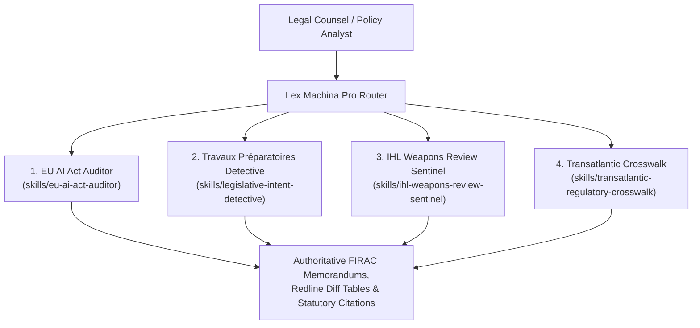

# Lex Machina Pro: Elite Legal & Regulatory Intelligence Suite

[](https://agensi.io/skills/lex-machina)
[](https://github.com/modelcontextprotocol)
[](#installation--agent-configuration)
[](https://github.com/a-vip/lex-machina)
[](LICENSE)

> **Institutional-grade AI regulation, travaux préparatoires redlines, and international humanitarian law reasoning for Claude Code, Cursor, and legal AI agents.**

Engineered for **AmLaw 100 / Magic Circle regulatory practices**, multilateral treaty delegations, corporate general counsels, and sovereign defense policy advisors. Paired with the remote stateless [`lex-machina`](https://github.com/a-vip/lex-machina) FastMCP engine, this suite equips AI agents with deterministic statutory reasoning, legislative intent reconstruction (*travaux préparatoires*), and multi-jurisdictional compliance auditing.

---

## The Four Flagship Legal Skills



### 1. [`eu-ai-act-auditor`](skills/eu-ai-act-auditor/SKILL.md)
- **Doctrinal Scope**: Full compliance review against **Regulation (EU) 2024/1689** (OJ L, 2024/1689).
- **Core Checks**:
  - **Article 5 Prohibitions**: Subliminal manipulation, vulnerability exploitation, social scoring, predictive policing, untargeted facial scraping, workplace emotion recognition, sensitive biometric categorization, real-time RBI in public spaces.
  - **Article 6 & Annex III Classification**: Product safety components vs. standalone critical domains.
  - **Article 6(3) Derogation**: Tests the 4 narrow procedural derogations and enforces the mandatory **profiling override**.
  - **Articles 51–55 General-Purpose AI Models**: $10^{25}$ FLOPs systemic risk threshold, copyright compliance summary (Art. 53(1)(d)), and adversarial red-teaming.
  - **Article 27 FRIA**: Fundamental Rights Impact Assessment for public and essential deployers.

### 2. [`legislative-intent-detective`](skills/legislative-intent-detective/SKILL.md)
- **Doctrinal Scope**: CJEU teleological and contextual statutory interpretation (*Cilfit*, Case 283/81; *Nilsson*, Case C-162/97).
- **Core Capabilities**:
  - Traces clauses chronologically across: **Commission Proposal** (`COM(2021) 206`) $\rightarrow$ **Council General Approach** (`14954/22`) $\rightarrow$ **Parliament Mandate** (`P9_TA(2023)0236`) $\rightarrow$ **Trilogue Compromise** (`ST 5662/24`) $\rightarrow$ **Official Journal** (`32024R1689`).
  - Runs **institutional `git blame`** to establish which co-legislator introduced specific phrases or exceptions.
  - Generates unified statutory redlines with institutional attribution.

### 3. [`ihl-weapons-review-sentinel`](skills/ihl-weapons-review-sentinel/SKILL.md)
- **Doctrinal Scope**: Operationalizes **Article 36 of Additional Protocol I (1977)** to the 1949 Geneva Conventions and the **UN CCW GGE 11 Guiding Principles on Lethal Autonomous Weapons Systems (LAWS)**.
- **Core Capabilities**:
  - Evaluates automated and autonomous weapons against customary IHL rules: Distinction (Art. 48/51), Proportionality (Art. 51(5)(b)), Feasible Precautions & Strike Abort (Art. 57), and Superfluous Injury (Art. 35).
  - Enforces the CCW GGE two-tier normative framework (prohibited vs. regulated autonomous systems).

### 4. [`transatlantic-regulatory-crosswalk`](skills/transatlantic-regulatory-crosswalk/SKILL.md)
- **Doctrinal Scope**: Comparative regulatory harmonization across four major regimes:
  1. **European Union**: EU AI Act (Regulation (EU) 2024/1689)
  2. **United States**: NIST AI Risk Management Framework 1.0 (NIST AI 100-1) & Generative AI Profile (NIST AI 600-1)
  3. **People's Republic of China**: CAC Algorithmic Recommendation, Deep Synthesis, and Generative AI Trilogy (Orders 9, 12, 15)
  4. **Council of Europe**: Framework Convention on AI (CETS No. 225)
- **Core Capabilities**: Maps governance controls into a single unified audit matrix, eliminating duplicate compliance overhead.

---

## Installation & Agent Configuration

### 1. Claude Code
Add to your Claude Code workspace or user config:
```bash
# Add this skill repository to your project
git clone https://github.com/a-vip/lex-machina-skills.git .skills/lex-machina
```
Claude Code automatically ingests the instructions from [`claude/CLAUDE.md`](claude/CLAUDE.md).

### 2. Cursor
Place or symlink `.cursorrules` or `.cursor/rules/legal-analysis.mdc` into your project root. Cursor will automatically enforce partner-level FIRAC methodology and statutory verification on all legal prompts.

### 3. Claude Desktop / FastMCP Client
Add the `lex-machina` MCP server to your `claude_desktop_config.json`:
```json
{
  "mcpServers": {
    "lex-machina": {
      "command": "python",
      "args": ["-m", "mcp_server.server"],
      "env": {
        "LEX_MACHINA_REPO": "a-vip/lex-machina",
        "LEX_MACHINA_BRANCH": "corpus"
      }
    }
  }
}
```

---

## agensi.io & Marketplace Integration
This repository is packaged with the official [`marketplace.json`](marketplace.json) manifest complying with the `agensi.io/schemas/skill-manifest-v1.json` standard.

To publish or update your listing on agensi.io:
```bash
npx agensi-cli publish --manifest marketplace.json
```

---

## Deliverable Templates
All skills generate institutional-quality work products utilizing standardized templates:
- [**Formal Legal Memorandum Template (FIRAC)**](templates/legal_memorandum_template.md)
- [**Executive Leadership Briefing Template**](templates/executive_briefing_template.md)

---

## Licensing
This project is licensed under a **Dual Academic / Commercial Model**:
- **Academic & Non-Profit Use**: [Creative Commons Attribution-NonCommercial 4.0 (CC BY-NC 4.0)](LICENSE).
- **Commercial Law Firms & Enterprise Deployments**: Requires an [Enterprise Commercial License](LICENSE). Inquiries: `licensing@lex-machina.org`.
