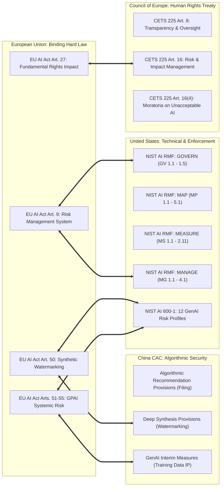

# Skill: Transatlantic & Multilateral AI Regulatory Crosswalk

## Mission & Purpose
Global enterprise AI deployers operate simultaneously across the European Union, United States, United Kingdom, and Asia-Pacific. While the **EU AI Act** imposes mandatory binding statutory obligations with penalties up to €35M / 7% of turnover, the **US NIST AI RMF** provides voluntary technical standards reinforced by Federal Trade Commission (FTC) enforcement and Executive Order 14110, **China CAC** mandates administrative algorithmic registration and training data reviews, and the **Council of Europe CETS 225** establishes international human rights treaty obligations.

This skill harmonizes compliance obligations across these regimes, eliminating redundant auditing and providing a single unified risk assessment.

---

## Tool Integration via `lex-machina` MCP Server

- `get_provision("eu/ai-act", "articles/article-009.md")`: EU AI Act Risk Management System.
- `get_provision("national/us/nist-ai-rmf", "articles/article-001.md")`: NIST AI RMF Function 1 (GOVERN).
- `get_provision("national/us/nist-ai-rmf", "articles/article-002.md")`: NIST AI RMF Function 2 (MAP).
- `get_provision("national/us/nist-ai-rmf", "articles/article-003.md")`: NIST AI RMF Function 3 (MEASURE).
- `get_provision("national/us/nist-ai-rmf", "articles/article-004.md")`: NIST AI RMF Function 4 (MANAGE).
- `get_provision("national/cn/cac-ai-measures", "articles/article-007.md", as_of="generative_ai_measures_2023")`: China CAC Training Data & IP rules.
- `get_provision("coe/ai-convention", "articles/article-016.md", as_of="adopted_convention_cets_225")`: CoE CETS 225 Risk & Impact Framework.
- `get_citation_graph("eu/ai-act")`: Discover cross-jurisdictional treaty and standard linkages.

---

## The 4-Way Harmonization Architecture

---

## 4-Step Crosswalk Audit Protocol

### Step 1: Governance & Risk Management Baseline
- Verify whether the organization's **NIST AI RMF GOVERN (GV)** and **MANAGE (MG)** policies satisfy the continuous iterative requirements of **EU AI Act Article 9**.
- Map documentation: Does the NIST TEVV (Testing, Evaluation, Verification, and Validation) repository satisfy **EU AI Act Annex IV** technical documentation standards?

### Step 2: Generative AI & Foundation Model Alignment
- Map the **12 NIST AI 600-1 GenAI risk categories** (CBRN uplift, confabulation, dangerous recommendations, data privacy, environmental impacts, harmful bias, information integrity, IP, obscene content, value chain security) against:
  - **EU AI Act Article 55** systemic risk evaluations.
  - **China CAC GenAI Measures Article 4 & 7** core socialist values, training data legitimacy, and non-infringement.

### Step 3: Provenance, Labeling, and Watermarking
- **EU AI Act Art. 50(2)**: Machine-readable, detectable format.
- **China CAC Deep Synthesis Provisions Art. 16–17**: Implicit metadata watermarking logs + explicit conspicuous labels.
- **NIST AI 600-1 MANAGE 2.2**: C2PA cryptographic provenance and content watermarking standards.

### Step 4: Multi-Jurisdictional Reporting Memorandum
Synthesize a single **Global Regulatory Alignment Matrix** showing:
1. Universal Controls (satisfied across all 4 jurisdictions simultaneously).
2. Divergent Controls (unique requirements, such as China's CAC Algorithm Registry Filing or EU's CE Marking).
3. Strategic Roadmaps to achieve cross-border deployment with zero duplication of auditing expense.
