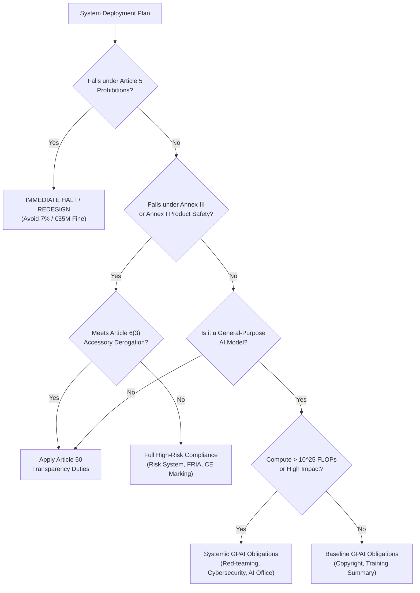

# EXECUTIVE REGULATORY BRIEFING: STATUTORY IMPACT & EXPOSURE

**CONFIDENTIAL // BOARD & GENERAL COUNSEL BRIEFING**

---

### 1. SUMMARY AT A GLANCE
- **System Evaluated**: [Product / Model Name]
- **Primary Finding**: [Prohibited / High-Risk / Permitted with Mandatory Transparency / Out of Scope]
- **Maximum Statutory Fine Exposure**:
  - Prohibited AI Practices: Up to **€35,000,000** or **7% of global annual turnover** (EU AI Act Art. 99(3)).
  - High-Risk & Operator Non-Compliance: Up to **€15,000,000** or **3% of global annual turnover** (EU AI Act Art. 99(4)).
  - Incorrect / Misleading Information: Up to **€7,500,000** or **1% of global annual turnover** (EU AI Act Art. 99(5)).
  - General-Purpose AI Fines: Up to **€15,000,000** or **3% of global annual turnover** (EU AI Act Art. 101).

---

### 2. TRAVAUX PRÉPARATOIRES REDLINE SUMMARY
*(How the law changed between draft stages, and what that means for your legal risk)*

| Clause / Feature | Initial Commission Proposal (2021) | Parliament Mandate (2023) | Enacted Official Journal (2024) | Business Impact |
| :--- | :--- | :--- | :--- | :--- |
| **Biometric Processing** | Law enforcement carve-out wide | Total public ban across all actors | Strictly limited judicial warrant carve-out | Requires pre-authorization |
| **Foundation / GPAI Models** | Not contemplated in draft | Broad obligations on all models | Tiered: Baseline vs. Systemic Risk ($>10^{25}$ FLOPs) | Tiered compliance roadmap |
| **Fundamental Rights Impact** | Not required for private actors | Broad mandatory FRIA | Bodies governed by public law & essential services | Focused deployment scope |

---

### 3. IMMEDIATE DECISION TREE FOR LEADERSHIP

---

### 4. PRIORITY 90-DAY COMPLIANCE ROADMAP
1. **Week 1–2**: Conduct algorithmic red-line review against Article 5 prohibitions.
2. **Week 3–6**: Establish Article 9 Risk Management System and technical documentation dossier (Annex IV).
3. **Week 7–10**: Complete Article 27 Fundamental Rights Impact Assessment (if applicable).
4. **Week 11–12**: Execute Article 50 machine-readable synthetic watermarking and user disclosures.
